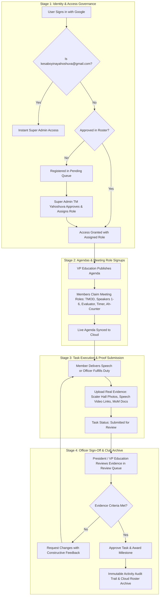

# 🏆 TOASTMASTERS TASK HUB
> **SpeakUp Scaler Toastmasters Club #28681022** • *District 227 • Division E • Area 04*  
> *Where Leaders Are Made • Learn • Speak • Lead*

[](https://reactjs.org/)
[](https://www.typescriptlang.org/)
[](https://vitejs.dev/)
[](https://tailwindcss.com/)
[](https://supabase.com/)
[](https://vercel.com/)

A centralized, enterprise-grade task accountability, proof-verification, and meeting agenda governance platform built for Toastmasters leadership teams and club members.

---

## 🏛️ Executive Workflow & Club Pipeline



---

## 👥 Flow of Everyone: Roles & Responsibilities

| Role | Officer / Member | Committee | Key Responsibilities & To-Dos |
| :--- | :--- | :--- | :--- |
| **Super Admin & Secretary** | **TM Yahoshuva Kesaboyina** | Finance & Records | Manages master Minutes of the Meeting (MoM), approves member access requests, configures system permissions, and maintains cloud synchronization. |
| **Club President** | **TM Arunima Vats** | Executive Committee | Presides over club meetings with gavel; oversees charter compliance, executive alignment, and reviews speech evidence. |
| **VP Education (VPE)** | **TM Shakthi Sivapriya** | Education & Meeting Roles | Publishes meeting agendas, schedules Pathways speeches, assigns mentors, coordinates evaluations, and conducts educational masterclasses. |
| **Sergeant at Arms (SAA) / VPM** | **TM Ashish Patel** | Operations & Logistics | Prepares meeting hall and timing lights/cards (Green/Yellow/Red); welcomes guests; coordinates Moments of Truth evaluations. |
| **VP Public Relations (VPPR)** | **TM Harshitha** | Public Relations & Media | Designs meeting flyers and theme graphics; photographs award winners; publishes meeting recaps on Instagram & LinkedIn. |
| **Prepared Speakers** | **TM Vedali, TM Rehan, TM Prakrit** | General Membership | Deliver Level 1–5 Pathways milestone speeches on stage; submit video proofs and evaluator feedback notes. |
| **Club Members & Applicants** | **Abdul Rahman & New Members** | General Membership | Rehearse Level 1 Icebreaker speeches; participate in impromptu Table Topics; take up functional meeting roles (Timer, Ah-Counter, Grammarian). |

---

## 🎯 Real Tasks & Proof-Based Completion Standards

A task is **never** completed by merely ticking a checkbox. Every milestone requires attached proof and reviewer sign-off:

1. **Prepared Speeches (Levels 1–5)**:
   - 5–7 minute speech delivered on stage at Scaler Hall.
   - Evidence required: On-stage photograph, recorded video timestamp link, and written evaluator feedback.
2. **Toastmaster of the Day (TMOD)**:
   - Meeting theme introduction, transitions, and timing agenda management.
   - Evidence required: Meeting agenda link and session photo.
3. **Timer & Ah-Counter**:
   - Holding Green (5m), Yellow (6m), and Red (7m) cards steadily; recording filler words.
   - Evidence required: Official timing log sheet / script copy.
4. **Minutes of the Meeting (MoM)**:
   - Consolidated record containing attendance counts, speech titles, and award winners.
   - Evidence required: Approved `.docx` or `.md` MoM archived in club records within 48 hours.

---

## 🛠️ Technology Stack

- **Frontend Framework**: React 18 with TypeScript
- **Bundler & Tooling**: Vite 5
- **Styling & Design System**: Tailwind CSS 3.4 (Toastmasters Loyal Blue `#004165`, True Maroon `#772432`, Happy Yellow `#F2DF74`, Cool Gray `#A9B2B1`)
- **Backend & Cloud Database**: Supabase (PostgreSQL with Row Level Security)
- **Authentication**: Supabase Auth (Google OAuth) + Local Storage Fallback
- **Analytics & Observability**: Vercel Analytics (`@vercel/analytics`)

---

## 🚀 Deployment & Vercel Configuration

### 1. Environment Variables in Vercel
In the Vercel Dashboard under **Project Settings &rarr; Environment Variables**, configure:

| Key | Type | Value / Description |
| :--- | :--- | :--- |
| **`VITE_SUPABASE_URL`** | Plain Text | `https://your-project.supabase.co` |
| **`VITE_SUPABASE_ANON_KEY`** | Secret | `eyJhbGciOi...` *(your anon/public key)* |

### 2. Google OAuth in Supabase
1. In Google Cloud Console, create OAuth 2.0 Client credentials:
   - **Authorized JavaScript origins**: `https://<your-project>.supabase.co`, `https://<your-app>.vercel.app`
   - **Authorized redirect URIs**: `https://<your-project>.supabase.co/auth/v1/callback`
2. In Supabase Dashboard &rarr; **Authentication &rarr; Providers &rarr; Google**:
   - Toggle **Enable Google provider**: ON
   - Paste your **Client ID** and **Client Secret**.
3. Under **Authentication &rarr; URL Configuration &rarr; Redirect URLs**:
   - Add your live production Vercel domain (`https://<your-app>.vercel.app/**`).

### 3. Vercel Analytics
`@vercel/analytics` is installed and initialized in `src/main.tsx`. Page views and visitor metrics will automatically begin reporting once deployed.

---

## 💻 Local Development

```bash
# Clone the repository
git clone https://github.com/Yahoshuva138/TOASTMASTER.git
cd TOASTMASTER/TOASTMASTERS_TASK_HUB

# Install dependencies
npm install

# Start local Vite development server
npm run dev

# Build production bundle
npm run build
```

---

## 📄 License & Governance
Official property of **SpeakUp Scaler Toastmasters Club #28681022**. Managed under the direction of Super Admin **TM Yahoshuva Kesaboyina** (`kesaboyinayahoshuva@gmail.com`).
